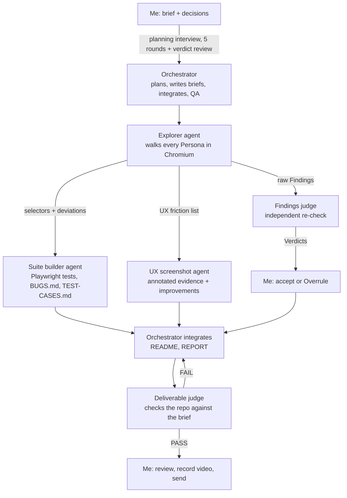

# How AI was used: the orchestration

I directed a small team of AI agents and made every decision that shaped the deliverable myself. This page explains who did what, how they were checked, and what I did. The real prompts are in [`ai-workflow/prompts/`](ai-workflow/prompts/) and my decisions are in [`ai-workflow/decisions.md`](ai-workflow/decisions.md).

## Tools

- **Harness:** [omp](https://github.com/can1357/oh-my-pi), a terminal AI coding agent that can spawn sub-agents, drive a real Chromium browser, and run shell commands.
- **Model:** Claude Opus 5.5 (Anthropic) for the orchestrator, every sub-agent, and both judges.
  - My workspace config planned a different model (GPT-6 Sol) for the executor sub-agents. This harness has per-call model selection switched off, so they ran on the orchestrator's model.
  - A typed-check model (Jev, via OpenRouter) was configured as an optional extra check. It returned `402 Payment Required`, so all checking fell back to Opus, as the config prescribes.
  - I mention both because the brief asks where AI went wrong. The tooling did not always do what the config said.
- **Cost to the reviewer:** none. The test suite is plain Playwright and needs no API key.

## Pipeline

## Stages

1. **Planning interview.** Before writing any code, the orchestrator interviewed me in rounds about the open decisions: stack, scope, pass/fail semantics, how open to be about AI authorship, judge design. It gave a recommendation for each, and I decided. I overruled it twice: I chose not to build a separate free-model agent, and I raised the scope from "intern-simple" to "best effort". Shared terms such as Bug, UX Issue, Known Bug, and Severity versus Priority were fixed in [`CONTEXT.md`](../CONTEXT.md) during this interview, so every agent used the same vocabulary.
2. **Exploration.** One agent drove a real browser through every Persona: login, inventory, sorting, product pages, cart, checkout, menu, logout and URL guards, on desktop and on a 390×844 phone viewport. It recorded deviations from `standard_user` together with measurements and screenshots. Its output is kept unedited in [`ai-workflow/findings/explorer-raw.md`](ai-workflow/findings/explorer-raw.md), because it is AI output that had not yet been checked.
3. **Build, in parallel.**
   - The suite builder wrote the Playwright suite under a fixed contract. Before it could pin anything as a Known Bug, it had to reproduce the failure on the live site and rule out a mistake in its own test.
   - The UX agent produced annotated screenshots with a script, after re-verifying each claim it relied on.
4. **Findings judge.** A separate agent re-checked every raw Finding and classified it as Bug, UX Issue, or Rejected, against a fixed rubric ([prompt](ai-workflow/prompts/03-findings-judge.md)). I then accepted or overruled each Verdict. The results are in [`judging/findings-verdicts.md`](judging/findings-verdicts.md).
5. **Deliverable judge.** An independent agent that had not seen the build checked the repository against the recruiter's brief, using a 10-point rubric ([prompt](ai-workflow/prompts/04-deliverable-judge.md)). The result is in [`judging/deliverable-verdict.md`](judging/deliverable-verdict.md).

## What I did

- Set every design constraint the agents worked under (see [`decisions.md`](ai-workflow/decisions.md)).
- Delegated the top-five UX selection to the orchestrator's recommendation, then reviewed the result before sending.
- Decided every contested Verdict from the Findings judge, including two Overrules, and accepted the rest as the judge wrote them.
- Reviewed the code, the bug reports and the report before sending.
- Recorded the walkthrough video (linked in the README).
