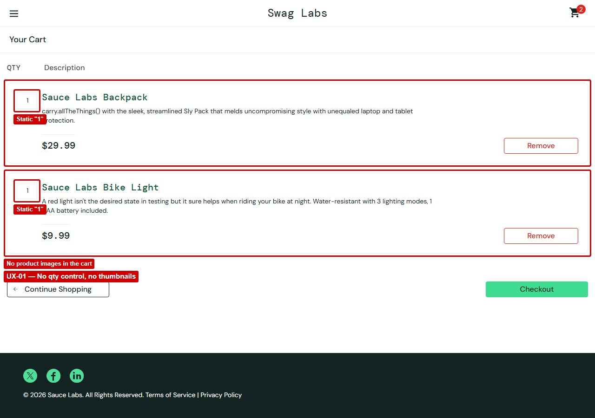
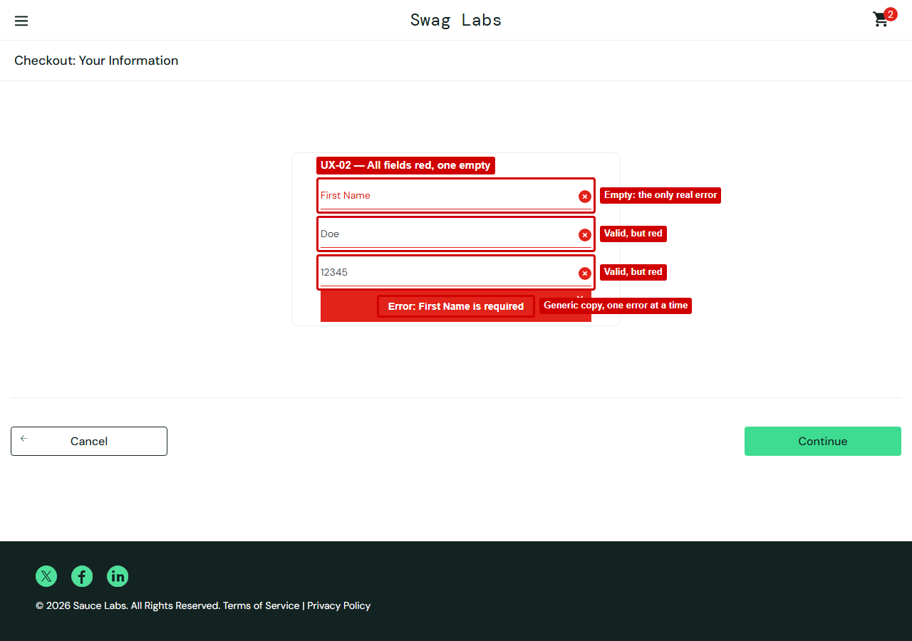
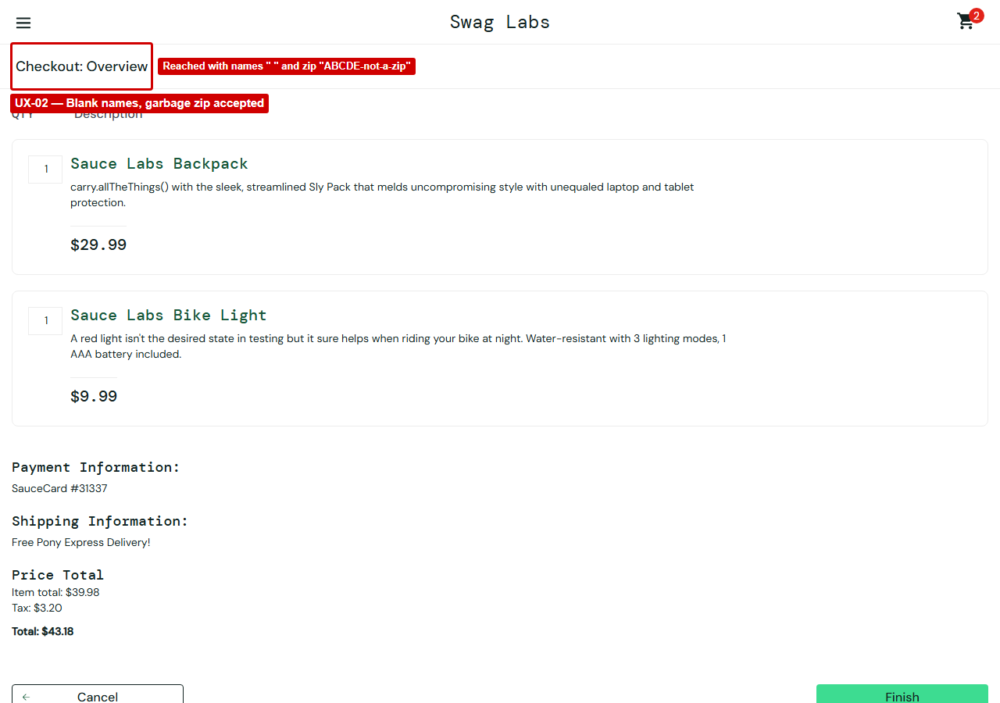
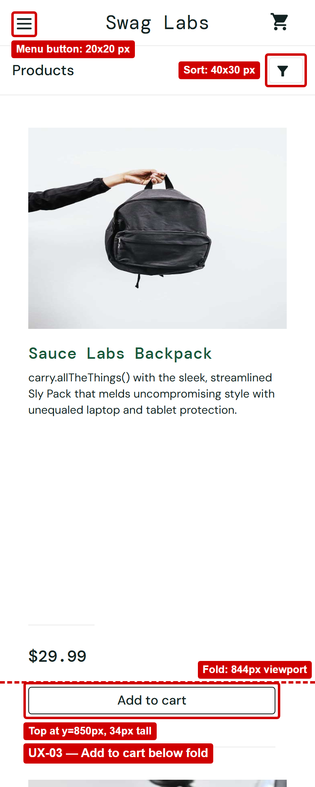
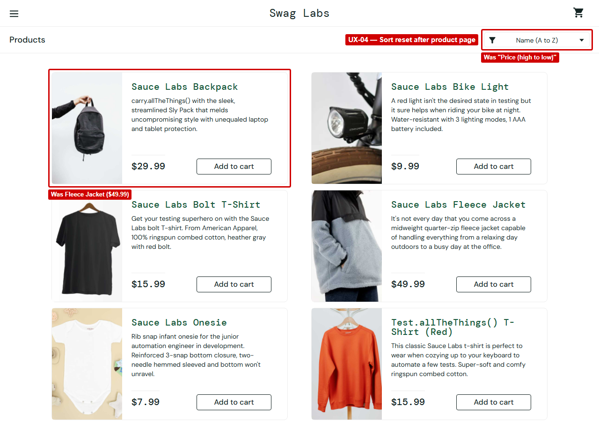
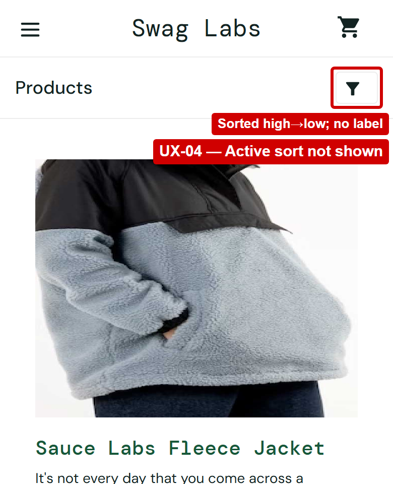
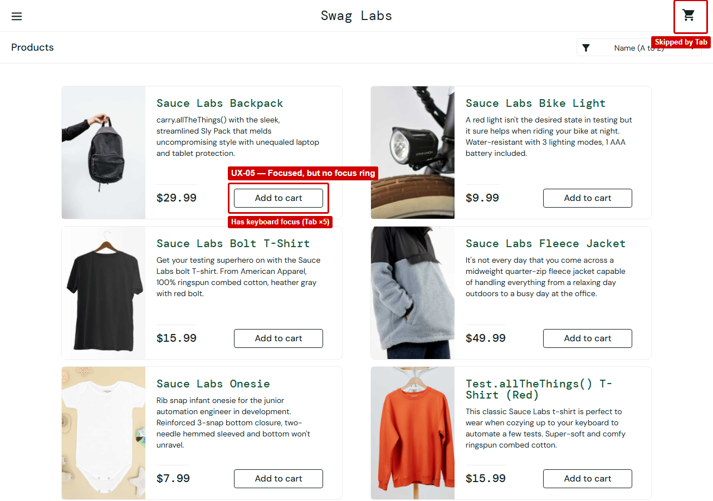

# UX Issues

Five UX Issues found on SauceDemo with the Baseline Persona (`standard_user`). Each one works as built but confuses, slows down, or blocks a real Shopper. Every claim below was measured on the live site, and `scripts/ux-screenshots.ts` checks the claims again each time it regenerates the annotated screenshots (`npm run ux:screenshots`). If a claim no longer holds, the script stops without saving that image.

Viewports: desktop 1280x900 and phone 390x844 (deviceScaleFactor 2, touch), headless Chromium.

---

## UX-01: The cart has no quantity control and no product thumbnails

**What the Shopper experiences:** A Shopper who wants two backpacks can't add a second one: after the first click, the button on the product changes to "Remove". The cart rows show only text, so the Shopper has to read each name to check the order.

**Evidence:** With 2 items in the cart, each quantity is a static `
1
`. The cart list has 0 `<input>`/`<select>` elements and 0 `` elements. The checkout overview looks the same.

**Why it matters:** Shoppers can't buy multiples, which caps average order value. Without images, Shoppers are slower to spot a wrong item and more likely to abandon the cart.

**Improvement:** Replace the static quantity with a −/+ stepper (min 1, max 10, with the subtotal updating live) and allow repeat adds from inventory. Show a 64px thumbnail of the existing product image in each cart and overview row.

**Effort:** M

---

## UX-02: Checkout form feedback is misleading and blank input is accepted

**What the Shopper experiences:** The Shopper leaves only First Name empty, but all three fields turn red. Fixing that field reveals the next error on the next submit. Names made only of spaces and the zip `ABCDE-not-a-zip` go straight through to the overview.

**Evidence:** All fields empty → `Error: First Name is required`. Fill First Name → `Error: Last Name is required`. With only First Name empty, all 3 inputs get class `error` (red border `rgb(226, 35, 26)`), and none has `aria-invalid`. The banner has `role="alert"`. `"   "` / `"   "` / `ABCDE-not-a-zip` → `/checkout-step-two.html`.

**Why it matters:** WCAG 3.3.1 Error Identification: valid fields are shown as errors. WCAG 3.3.3 Error Suggestion: the message gives no guidance. The extra round trips cause checkout drop-off, and orders end up with unusable shipping data.

**Improvement:** On submit, trim and validate every field. Mark only the invalid fields with `aria-invalid="true"` and an inline message connected through `aria-describedby`, for example "Enter your first name" or "Enter a 5-digit ZIP code". Show all errors at once.

**Effort:** S

---

## UX-03: On mobile, the first Add to cart sits below the fold and tap targets are tiny

**What the Shopper experiences:** On a phone, the first product fills the whole screen, but its Add to cart button sits just out of view below a large blank area. The menu icon and the sort icon in the header are hard to hit.

**Evidence:** 390x844 viewport. The first Add to cart starts at y=850 and is 34px tall. It is pushed below the fold by a 256px empty gap between the description (bottom at y=517) and the price (y=773). The menu button is 20x20 px, and the sort control is 40x30 px.

**Why it matters:** The call to action is hidden at the moment the Shopper decides to buy, and the blank gap looks like the end of the card. The 20x20 menu button is below the 24px minimum of WCAG 2.5.8 Target Size (Minimum). It only passes through that criterion's spacing exception. It fails 2.5.5 Target Size (Enhanced, 44x44), and so do the sort control and Add to cart.

**Improvement:** Remove the fixed-height gap in product cards on narrow screens so the price and Add to cart sit directly under the description. Pad the menu button and sort control to 44x44 hit areas, and make Add to cart at least 44px tall.

**Effort:** S

---

## UX-04: The selected sort is lost after viewing a product

**What the Shopper experiences:** The Shopper sorts by Price (high to low), opens a product, and clicks "Back to products". The list is back in A–Z order, so the Shopper has to re-sort after every product visit. On a phone, nothing on screen shows which sort is active.

**Evidence:** Price (high to low) puts Sauce Labs Fleece Jacket ($49.99) first. After the PDP and "Back to products", the select value is `az` with label `Name (A to Z)`, and Sauce Labs Backpack is first. The browser Back button keeps `hilo`, so only the in-app button resets the sort. At 390px, `active-option` is `display:none` and the select is a 40x30 icon.

**Why it matters:** Comparison shopping across several products becomes tedious, and Shoppers lose their place.

**Improvement:** Store the sort in the URL (`/inventory.html?sort=hilo`) and keep it in the "Back to products" link, or restore it from `sessionStorage`. On mobile, show a short label next to the icon, for example "Price ↓".

**Effort:** S

---

## UX-05: Keyboard users can't see focus and can't reach the cart

**What the Shopper experiences:** A keyboard user presses Tab and sees no sign of where focus is. Even with careful counting, there is no way to reach the cart, so checkout can't be completed without a mouse.

**Evidence:** The Tab order is burger → sort → image link → title link → Add to cart → …. Add to cart matches `:focus-visible`, yet its computed `outline-style` and `box-shadow` are `none`, and the focused and unfocused element screenshots are pixel-identical. The cart is `<a role="button">` with no `href` or `tabindex`. It never receives Tab focus, and `focus()` has no effect. The menu has no Cart entry.

**Why it matters:** This fails WCAG 2.4.7 Focus Visible and 2.1.1 Keyboard. It is a hard blocker for keyboard-only and switch users.

**Improvement:** Add a `:focus-visible` outline (2px, offset 2px, contrast of at least 3:1). Make the cart `<a href="/cart.html">` so it gets native focus and Enter handling.

**Effort:** S

---

## Notes on the exploratory Findings

Every claim annotated here reproduced. One Finding was rejected and one needed a correction:

- The exploratory run reported "Finish below the fold on the mobile overview" as a UX Issue. The Findings judge rejected it: Finish coming after the items and totals is the normal checkout order, and the judge measured it only 16px below the fold with 1 item. The candidate accepted that Verdict, so it is not part of UX-03.
- "Sort resets after visiting a product page" is true only when the Shopper uses the in-app "Back to products" button. The browser Back button keeps the selected sort.
